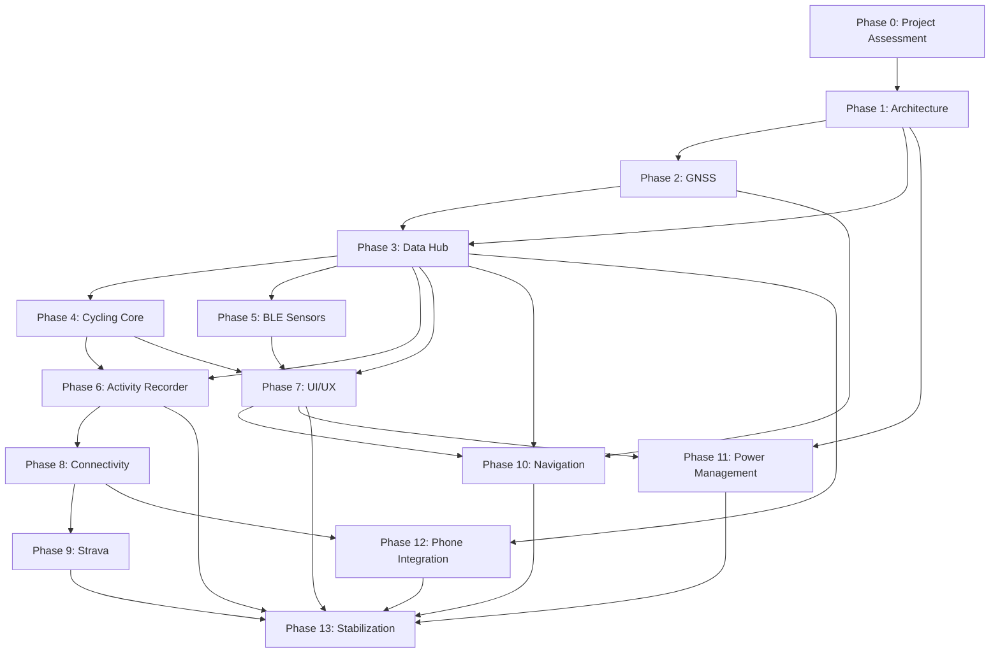

# ROADMAP.md

# Bike Computer Development Roadmap

## 1. Purpose

This document defines the development roadmap for the Bike Computer project.

It establishes:

- Development phases.
- Feature priorities.
- Dependencies between components.
- Expected deliverables.
- Validation requirements.
- Completion criteria.

The roadmap is intended to guide the Orchestrator and all specialized AI agents.

Development must be incremental. Each phase should establish a stable foundation for the next one.

## 2. Product Vision

The long-term objective is to develop an advanced cycling computer inspired by devices such as the Garmin Edge 1050.

The device should provide:

- Real-time cycling metrics.
- Configurable dashboards.
- GNSS positioning.
- BLE sensor support.
- Activity recording.
- FIT and GPX export.
- Wi-Fi connectivity.
- Strava integration.
- Route navigation.
- Offline maps.
- Phone integration.
- Advanced cycling analysis.

The project must prioritize reliability, data integrity, responsiveness, and maintainability.

## 3. Development Principles

All development phases must follow these principles:

1. Stabilize existing functionality before adding complexity.
2. Preserve working hardware configurations.
3. Separate hardware drivers from application logic.
4. Keep Cycling Core independent of LVGL.
5. Use the Data Hub as the central source of application data.
6. Implement features incrementally.
7. Validate each component before integration.
8. Protect recorded activity data.
9. Avoid unnecessary dependencies.
10. Document architectural decisions.
11. Do not implement speculative hardware features.
12. Require explicit approval before every file modification.

## 4. Priority Levels

| Priority | Meaning |
|---|---|
| P0 | Critical foundation or reliability requirement |
| P1 | Essential product functionality |
| P2 | Important enhancement |
| P3 | Advanced or optional feature |

A higher-priority feature should normally be completed before lower-priority dependent features.

## 5. Development Phases

<text emphasis="strong">Phase 0 — Project Assessment and Baseline</text>

<badge color="success">Foundation</badge>

**Priority:** P0

### Objectives

Understand the existing firmware before introducing architectural changes.

### Tasks

- Inspect the complete project structure.
- Review the existing ESP-IDF configuration.
- Identify existing drivers and components.
- Review the existing LVGL integration.
- Review UART GNSS implementation.
- Review BLE implementation.
- Identify shared data structures.
- Identify concurrency and synchronization issues.
- Review memory allocation.
- Identify incomplete functions and known defects.
- Establish a baseline of existing functionality.

### Deliverables

- Existing project audit.
- Hardware and software inventory.
- List of known defects.
- Initial risk assessment.
- Agreed implementation sequence.

### Completion criteria

- Existing functionality is understood.
- Hardware ownership is documented.
- Critical defects are identified.
- Architectural changes can be planned without guessing.

---

<text emphasis="strong">Phase 1 — Firmware Foundation and Architecture</text>

<badge color="success">P0</badge>

### Objectives

Establish a maintainable architecture for future development.

### Tasks

- Define module boundaries.
- Define common error-handling conventions.
- Define logging conventions.
- Define task ownership.
- Define synchronization rules.
- Define component initialization order.
- Define configuration management.
- Define memory allocation policies.
- Establish hardware abstraction boundaries.

### Main components

- Hardware/BSP.
- GNSS driver.
- BLE connectivity.
- Data Hub.
- Cycling Core.
- Activity Recorder.
- Storage.
- Connectivity.
- UI/UX.

### Deliverables

- Stable project architecture.
- Component interfaces.
- Documented data contracts.
- Initialization and shutdown strategy.

### Dependencies

Phase 0.

### Completion criteria

- Components have clear responsibilities.
- Shared resources have explicit ownership.
- UI does not access hardware directly.
- Cycling Core does not depend on LVGL.
- Data flow between components is documented.

---

<text emphasis="strong">Phase 2 — GNSS Reliability</text>

<badge color="success">P0</badge>

### Objectives

Provide reliable position, speed, and time information from the FlyFishRC M10 Mini.

### Tasks

- Verify the actual UART configuration.
- Validate NMEA parsing.
- Validate checksum handling.
- Implement correct GNSS validity checks.
- Normalize timestamps.
- Handle loss of GNSS reception.
- Detect stale data.
- Implement receiver reconnection or recovery behavior where applicable.
- Validate position and speed measurements.
- Document supported receiver features.

### Important constraints

- GNSS UART RX: GPIO43.
- GNSS UART TX: GPIO44.
- Respect the existing RS485 hardware/path modification.
- Do not assume baud rate or receiver output configuration.
- Do not send unverified UBX commands.

### Deliverables

- Reliable GNSS driver.
- Normalized GNSS data.
- GNSS diagnostics.
- Documented receiver configuration.

### Dependencies

Phase 1.

### Completion criteria

- Valid NMEA data is parsed correctly.
- Invalid messages are rejected.
- Reception loss is detected.
- Stale measurements are not treated as current.
- GNSS data is available through a stable interface.

---

<text emphasis="strong">Phase 3 — Data Hub</text>

<badge color="success">P0</badge>

### Objectives

Create a unified data interface for the entire application.

### Tasks

- Define normalized measurement structures.
- Implement measurement timestamps.
- Implement validity and freshness handling.
- Define source identification.
- Define source quality.
- Implement per-metric source selection.
- Implement source fallback.
- Implement source hysteresis.
- Define update notifications.
- Define synchronization mechanisms.

### Initial metrics

- Position.
- Speed.
- Altitude.
- Heading.
- GPS fix.
- Satellite information.
- Heart rate.
- Cadence.
- Power.
- Temperature.

Some metrics will initially be unavailable until the corresponding sensors are integrated.

### Deliverables

- Data Hub module.
- Data contracts.
- Source-selection policies.
- Unit conventions.
- Data freshness rules.

### Dependencies

Phases 1 and 2.

### Completion criteria

- Application components use normalized data.
- Data validity is explicit.
- Stale values are identified.
- Source changes do not cause unstable switching.
- Consumers do not access hardware drivers directly.

---

<text emphasis="strong">Phase 4 — Cycling Core</text>

<badge color="success">P0</badge>

### Objectives

Implement reliable cycling calculations independently of the user interface.

### Tasks

- Calculate trip distance.
- Calculate instantaneous speed.
- Calculate average speed.
- Calculate moving time.
- Calculate elapsed time.
- Calculate stopped time.
- Calculate maximum speed.
- Calculate elevation gain and loss.
- Calculate gradient.
- Implement ride-state detection.
- Define reset and pause behavior.

### Deliverables

- Cycling Core module.
- Metric calculation interfaces.
- Unit tests.
- Documented calculation rules.

### Dependencies

Phase 3.

### Completion criteria

- Calculations use validated input data.
- Distance integration is reliable.
- Invalid GNSS measurements do not corrupt metrics.
- Moving and elapsed time are handled correctly.
- Calculations are independent of LVGL.

---

<text emphasis="strong">Phase 5 — BLE Cycling Sensors</text>

<badge color="success">P1</badge>

### Objectives

Integrate standard cycling sensors through BLE.

### Tasks

- Implement BLE scanning.
- Implement device discovery.
- Implement connection management.
- Implement sensor identification.
- Implement Heart Rate Service.
- Implement Cycling Speed and Cadence Service.
- Implement Cycling Power Service.
- Implement Battery Service.
- Implement sensor freshness monitoring.
- Implement reconnection behavior.
- Implement sensor selection and configuration.

### Supported sensor categories

- Heart rate.
- Wheel speed.
- Cadence.
- Power meter.

### Deliverables

- BLE sensor manager.
- Standard service parsers.
- Sensor connection status.
- Sensor configuration interface.
- Data Hub integration.

### Dependencies

Phases 1 and 3.

### Completion criteria

- Supported sensors can be discovered.
- Connections are stable.
- Measurements are parsed correctly.
- Invalid and stale data are identified.
- BLE sensor data reaches the Data Hub.

---

<text emphasis="strong">Phase 6 — Activity Recording and Storage</text>

<badge color="success">P1</badge>

### Objectives

Implement reliable offline activity recording.

### Tasks

- Implement activity lifecycle.
- Implement recording state management.
- Implement periodic data sampling.
- Implement persistent storage.
- Implement recovery after unexpected interruption.
- Implement activity metadata.
- Implement file validation.
- Implement storage diagnostics.
- Implement FIT export.
- Implement GPX export.

### Deliverables

- Activity Recorder.
- Storage abstraction.
- Activity file format.
- Recording recovery mechanism.
- FIT and GPX export.

### Dependencies

Phases 3 and 4.

### Completion criteria

- Activities can be started and stopped.
- Recorded samples contain valid timestamps.
- Storage errors are handled.
- Interrupted recordings can be recovered where possible.
- Exported files pass independent format validation.

---

<text emphasis="strong">Phase 7 — UI/UX and Dashboard</text>

<badge color="success">P1</badge>

### Objectives

Develop a configurable and responsive cycling interface.

### Tasks

- Refactor existing LVGL integration where necessary.
- Define screen architecture.
- Implement dashboard widgets.
- Implement configurable metric layouts.
- Implement touch interaction.
- Implement navigation between screens.
- Implement activity controls.
- Implement sensor status indicators.
- Implement GNSS status indicators.
- Implement battery indicators.
- Implement settings screens.
- Implement error notifications.

### Main screens

- Main cycling dashboard.
- Activity summary.
- Sensor management.
- GNSS status.
- Connectivity settings.
- Device settings.
- Navigation screen.

### Deliverables

- UI architecture.
- Configurable dashboard.
- Touch interaction.
- Settings interface.
- Consistent visual design.

### Dependencies

Phases 1, 3, 4, and 5.

### Completion criteria

- UI consumes application-level data.
- UI does not directly access hardware.
- Screen transitions are responsive.
- Dashboard configuration is persistent.
- UI remains responsive during activity recording.

---

<text emphasis="strong">Phase 8 — Connectivity and Synchronization</text>

<badge color="info">P2</badge>

### Objectives

Enable network services and external synchronization.

### Tasks

- Implement Wi-Fi management.
- Implement network configuration.
- Implement secure HTTP communication.
- Implement time synchronization.
- Implement activity synchronization.
- Define companion-device communication.
- Implement retry and timeout policies.
- Implement authentication and credential storage.

### Deliverables

- Connectivity manager.
- Network configuration interface.
- Secure communication layer.
- Synchronization services.

### Dependencies

Phases 1 and 6.

### Completion criteria

- Wi-Fi can be configured.
- Network failures do not interrupt activity recording.
- Synchronization can resume after connection loss.
- Credentials are stored securely.
- Network operations have controlled resource usage.

---

<text emphasis="strong">Phase 9 — Strava Integration</text>

<badge color="info">P2</badge>

### Objectives

Allow recorded activities to be uploaded to Strava.

### Tasks

- Define the upload architecture.
- Implement OAuth authorization through a suitable companion or backend.
- Implement activity upload.
- Handle upload errors.
- Handle token expiration.
- Implement retry logic.
- Track synchronization status.
- Prevent duplicate uploads.

### Security constraints

- Never embed a Strava client secret in firmware.
- Use secure token handling.
- Do not expose credentials in logs.
- Follow Strava API requirements and applicable rate limits.

### Deliverables

- Strava synchronization workflow.
- Upload status management.
- Authentication integration.
- Error and retry handling.

### Dependencies

Phases 6 and 8.

### Completion criteria

- Activities can be uploaded.
- Authentication errors are handled.
- Failed uploads can be retried.
- Duplicate uploads are prevented where possible.

---

<text emphasis="strong">Phase 10 — Navigation and Maps</text>

<badge color="info">P2</badge>

### Objectives

Provide route navigation and map visualization.

### Tasks

- Define map data architecture.
- Define supported map format.
- Implement map storage.
- Implement map rendering.
- Implement route import.
- Implement route visualization.
- Implement route guidance.
- Implement turn notifications.
- Implement route deviation detection.
- Integrate GNSS positioning.

### Future features

- Offline maps.
- Route planning.
- Elevation profiles.
- Breadcrumb navigation.
- Turn-by-turn guidance.
- Route recalculation.
- Phone-assisted navigation.

### Deliverables

- Map renderer.
- Route manager.
- Route import interface.
- Navigation engine.
- Navigation UI.

### Dependencies

Phases 2, 3, 7, and 8.

### Completion criteria

- Routes can be imported.
- Current position is displayed correctly.
- Route progress is calculated.
- Navigation remains functional without network access when offline data is available.

---

<text emphasis="strong">Phase 11 — Power Management and Optimization</text>

<badge color="info">P2</badge>

### Objectives

Improve autonomy and system stability.

### Tasks

- Verify battery monitoring hardware.
- Implement battery monitoring.
- Implement charging status where supported.
- Implement display dimming.
- Implement peripheral power policies.
- Implement low-battery behavior.
- Measure real power consumption.
- Optimize task scheduling.
- Optimize memory usage.
- Validate long-duration operation.

### Deliverables

- Power Manager.
- Battery status interface.
- Power-saving policies.
- Power consumption report.

### Dependencies

Phases 1, 7, and 8, with coordination across all active components.

### Completion criteria

- Battery status is reliable.
- Power-saving policies do not interrupt recording.
- Critical low-battery behavior is predictable.
- Power consumption is measured on real hardware.

---

<text emphasis="strong">Phase 12 — Phone Integration</text>

<badge color="info">P2</badge>

### Objectives

Provide an optional companion-device experience.

### Tasks

- Define communication protocol.
- Implement phone pairing.
- Implement GPS fallback.
- Implement configuration synchronization.
- Implement activity transfer.
- Implement notification forwarding.
- Define phone application architecture.

### Deliverables

- Companion communication protocol.
- Device pairing workflow.
- Phone-side integration specification.
- GPS fallback implementation.

### Dependencies

Phases 3, 8, and 9.

### Completion criteria

- Phone connection is stable.
- Data exchange is documented.
- GPS fallback follows Data Hub source-selection rules.
- Loss of phone connection does not interrupt core device operation.

---

<text emphasis="strong">Phase 13 — Product Stabilization</text>

<badge color="success">P0</badge>

### Objectives

Validate the complete system under realistic cycling conditions.

### Tasks

- Perform long-duration testing.
- Validate activity recording reliability.
- Validate sensor reconnection.
- Validate GNSS recovery.
- Validate storage recovery.
- Validate low-battery behavior.
- Test all dashboard screens.
- Test navigation.
- Measure performance and memory.
- Review security.
- Review error handling.
- Resolve critical defects.

### Deliverables

- System test report.
- Known limitations.
- Release candidate.
- Updated documentation.
- Release checklist.

### Completion criteria

- No unresolved critical defects.
- No known activity data corruption issue.
- Stable operation during long rides.
- Acceptable memory usage.
- Acceptable UI responsiveness.
- Documented recovery behavior.
- All release requirements validated.

## 6. Dependency Overview

The following diagram represents the main development dependencies.

The diagram shows logical dependencies, not a requirement to complete every phase sequentially.

Independent work may proceed in parallel when interfaces and dependencies are stable.

## 7. Recommended Initial Execution Order

The initial implementation should focus on stabilizing the existing firmware.

Recommended order:

1. Complete Phase 0 project assessment.
2. Resolve critical existing defects.
3. Establish the component architecture.
4. Stabilize GNSS parsing and validity.
5. Implement the Data Hub.
6. Correct Cycling Core calculations.
7. Integrate BLE sensors.
8. Implement reliable activity recording.
9. Refactor and expand the dashboard.
10. Add connectivity and synchronization.

Advanced navigation, Strava integration, and phone assistance should follow after the core recording workflow is stable.

## 8. Feature Prioritization Rules

When deciding what to implement next, the Orchestrator must consider:

1. Does the feature fix a critical defect?
2. Does it improve data reliability?
3. Does it unblock another component?
4. Does it introduce hardware uncertainty?
5. Does it increase memory or power consumption?
6. Does it affect activity recording?
7. Is the required interface already stable?

Features that improve data integrity should normally take precedence over visual enhancements.

## 9. Phase Approval and Quality Review

The project uses:

- Autonomy: `supervised`.
- Collaboration: `central`.
- Agent scope: `project`.
- File approval: `approval_each`.
- Quality review: `major`.

The Orchestrator coordinates all work.

Agents must not independently expand the scope of an approved task.

Each implementation task must identify:

- Target phase.
- Objective.
- Files potentially affected.
- Dependencies.
- Risks.
- Validation plan.
- Expected deliverables.

Quality review is required for major or high-risk changes.

## 10. Definition of Done for Each Phase

A phase is complete only when:

- Its objectives are satisfied.
- Its deliverables are available.
- Relevant tests have been completed with approval.
- Known limitations are documented.
- No unresolved critical regression remains.
- Interfaces required by subsequent phases are stable.
- Required file approvals have been obtained.
- Documentation has been updated.

Completion must be based on verified results, not assumptions.

## 11. Roadmap Maintenance

This roadmap is a living document.

It must be updated when:

- Hardware capabilities change.
- Architectural decisions change.
- New dependencies are identified.
- Features are added or removed.
- Priorities change.
- Major defects alter the development sequence.
- A phase is completed.

Completed tasks should be marked with evidence or references to their implementation and validation.

Do not mark a phase complete merely because its code has been generated.

## 12. Long-Term Product Goals

After the main roadmap is completed, potential extensions include:

- Advanced training metrics.
- Training load estimation.
- Recovery indicators.
- Structured workouts.
- Climb detection and analysis.
- Advanced elevation profiles.
- Custom data fields.
- More sensor profiles.
- Advanced route planning.
- Enhanced companion application.
- Cloud-based activity analytics.

These extensions must not compromise the reliability of the core cycling computer.

## 13. Final Project Objective

The final product should be a reliable, standalone cycling computer capable of:

- Recording cycling activities.
- Displaying real-time metrics.
- Connecting to standard BLE cycling sensors.
- Using GNSS for positioning.
- Managing activities locally.
- Exporting standard activity formats.
- Synchronizing activities with external services.
- Navigating imported routes.
- Operating reliably without a permanent internet connection.

Reliability and data integrity are more important than feature count.